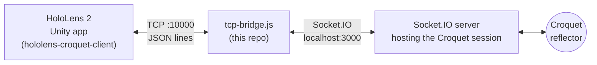

# croquet-hololens-bridge

A small Node.js bridge that lets a **HoloLens 2 / Unity** application take part in a
**[Croquet](https://croquet.io)** shared session.

Croquet runs in JavaScript, and a Unity app on HoloLens can't run it directly. This
bridge sits in the middle: it speaks plain **TCP + newline-delimited JSON** to the
headset and **Socket.IO** to the process hosting the Croquet session, forwarding
publish/subscribe messages in both directions.

It was built for my bachelor's thesis, together with the Unity client:
[hololens-croquet-client](https://github.com/TonelliLuca/hololens-croquet-client).

## Architecture



- **Headset side:** a TCP server on port `10000`. Each message is one JSON object
  followed by `\n`.
- **Croquet side:** a Socket.IO client connecting to `http://localhost:3000`, where
  the process running the Croquet session (model + view) exposes its events.
  That process is not part of this repository.

## Message protocol

### Unity → bridge → Croquet

| TCP message from Unity | Emitted to Socket.IO |
| --- | --- |
| `{"action":"join"}` | `join` |
| `{"action":"subscribe","scope":"cube","event":"updated"}` | `subscribe(scope, event)` |
| `{"action":"publish","scope":"cube","event":"sendData","data":{...}}` | `publish(scope, event, data)` |

`scope` and `event` are trimmed before being forwarded.

### Croquet → bridge → Unity

| Socket.IO event received | TCP message sent to Unity |
| --- | --- |
| `connection-ready` | `{"action":"connection-ready"}` (sent when a headset connects, once the Croquet side is ready) |
| `ready` | `{"action":"ready"}` |
| `event(scope, event, data)` | `{"action":"event","scope":...,"eventName":...,"data":...}` |
| `data`, `data-update` | logged only (forwarding is stubbed out) |

### Typical handshake

1. The bridge connects to the Socket.IO server and receives `connection-ready`.
2. The HoloLens app opens the TCP connection and receives `connection-ready`.
3. The app replies with `join`; the Croquet side answers with `ready`.
4. The app sends its `subscribe` messages, then publishes and receives events.

## Running it

Requirements: Node.js and a Socket.IO server hosting the Croquet session on
`localhost:3000`.

```bash
npm install
node tcp-bridge.js
# or, with auto-reload during development:
npx nodemon tcp-bridge.js
```

Then start the Unity app on the HoloLens (or in the Unity editor), pointing it at the
IP address of the machine running the bridge (see the client's README).

## Known limitations

This was a thesis prototype: it worked for the demo, but it is not production code.

- Host and ports (`localhost:3000`, `10000`) are hard-coded.
- Incoming TCP data is split on `\n` per chunk, so a JSON message split across two TCP
  chunks is dropped; parse errors are silently ignored.
- Broadcast listeners (`server.on('ready')`, `server.on('event-croquet')`, …) are
  registered for every new connection and never removed.
- `package.json` lists `net` and `node` as dependencies; neither is needed (`net` is
  built into Node.js).
